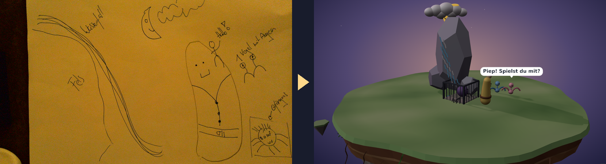
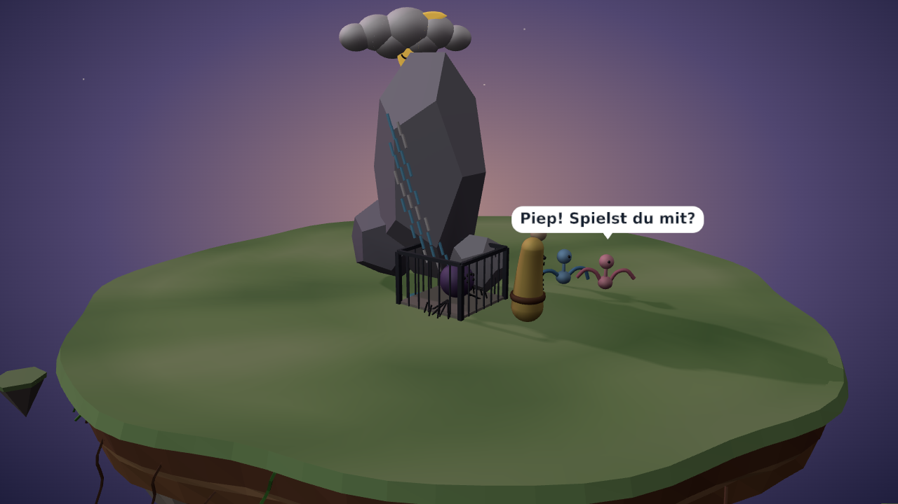

<p align="center">
  
</p>

<h1 align="center">Kritzel</h1>

<p align="center"><b>Draw on paper. Watch it come alive.</b><br>
A camera watches your sheet of paper; every drawing becomes a living thing on a floating 3D island.</p>

<p align="center"><sub><i>Kritzel</i> /ˈkʁɪtsl̩/, say <b>KRIT-sl</b> (rhymes with <i>pretzel</i>): German for <i>a scribble</i>.</sub></p>

<p align="center">
  
  
  
  
  
  
  
</p>

<p align="center">
  
</p>

Every figure, house or tree drawn on the sheet becomes a small low-poly thing on a
floating island in the browser, and the characters start living there. They walk around,
meet each other, make friends or run away, and talk in speech bubbles (or think in thought
clouds) while babbling softly. Draw a moon and night falls; draw a lamp or a campfire and
everyone gathers in its warm light. Label a drawing ("Vogel", "Fels") and it is read as
that. Erase a drawing and its thing goes away. Start a new sheet and the old island
shrinks away while a new one grows in.

From finished drawing to living thing takes about 20 seconds: a non-LLM change detector
waits until the hand has left the paper, then Claude reads the new drawing and writes a
small three.js module for it, which runs sandboxed and is checked before it reaches the
world.

<p align="center">
  
</p>

> **Status:** prototype, version 0.1.0 (see `VERSION`; the viewer shows it with the
> commit in its bottom line). The whole loop runs: camera → capture → generation →
> viewer. It is built and run by a small team of agents; see [Generation](#generation)
> for how drawings become code.

## Features

- **Paper to world, live:** capture notices a finished drawing (not a hand moving over
  the paper, not a slid sheet), generation turns it into a thing, the open page hot-reloads.
- **A living island:** characters have needs, moods, friendships and fears, find their
  way around obstacles ([rot.js](https://ondras.github.io/rot.js/)), talk, dance, play tag,
  and react to what's newly drawn.
- **Light and time of day:** dusk by default; a drawn sun or moon turns day or night,
  lamps and fires pool warm light and cast long shadows; characters get sleepy at night.
- **Speech and thought bubbles** in a colour per speaker, laid out so they don't cover
  each other.
- **A camera anywhere on your network:** share a camera with `scripts/camera_server.py`
  (e.g. a document camera on another machine via Tailscale) and pick it in the viewer.
  The picker also shows this computer's own cameras as a preview; capture uses network
  cameras for now.
- **Safe by design:** model-written code runs in a sandboxed child process (no network,
  no file writes, time limit), the page sends a strict Content-Security-Policy, and the
  server only serves the viewer.
- **Procedural sound:** Animal-Crossing-style babble and little effects, no sound files.

## What you need

- **A document camera looking straight down.** We use the
  [IPEVO V4K](https://www.amazon.de/dp/B079DLTG9F) (8 MP, USB, MJPEG at 1080p30, on a
  bendable arm). Any webcam works, but a camera fixed above the sheet gives steady,
  sharp frames, and that's what the change detection relies on.
- **A stable surface under the paper.** A board or desk mat the sheet can't slide on.
  Capture forgives a little shift, but a sheet that moves every time a child leans on it
  makes for false changes.
- **Plain white paper.** A4 or larger, and keep the whole sheet inside the camera's view
  (the outer edge of the frame is ignored).
- **Good, even light.** A desk lamp or daylight from the side, no hard shadows from
  hands or the camera arm. Warm room light works too; the viewer corrects for it.
- **A computer with a browser** to show the world: a laptop, a tablet next to the
  paper, or a TV.

## How it works

```
camera ──► frame ──► generation (generate/) ──────────► viewer/things/<thing>.js
                                                                  │
                                         browser polls every 0.5s │ hot reload
                                                                  ▼
                                     viewer/index.html  (three.js scene, island, sim)
```

- **`viewer/index.html`** — the engine: renderer, lights, orbit camera, speech-bubble
  sprites, hot reload, the "new world" transition, click-to-follow a character, and the
  sound toggle. It polls the server and reloads only what changed.
- **`viewer/mood.js`** — light and time of day: a drawn sun makes it day, a moon makes
  it night, lamps and fires light their surroundings; with neither sun nor moon the world
  sits in a soft dusk. Backdrop, light colours and lamps ease over a few seconds.
- **`viewer/weather.js`** — weather you can draw: rain (with puddles), snow, a rainbow,
  lightning; `mood.js` greys and dims the sky for it and the characters react.
- **`viewer/world.js`** — builds one world: the island plus every file in `things/`.
  Things can be added, changed or removed live; every character's position, mood and
  friendships survive reloads (even a full page reload, via `sessionStorage`).
- **`viewer/island.js`** — the floating island: grass top, layered soil, rocky
  underside, roots, optional waterfall and sky.
- **`viewer/characters.js`** — character models and rigs (`makePerson`) that drawn
  figures can reuse.
- **`viewer/sim.js`** — autonomous life on the island, driven by
  [rot.js](https://ondras.github.io/rot.js/): a grid with obstacles, speed-based
  scheduling, field of view (trees block sight), A* paths, needs, fear, traits and
  relationships; goals are picked by utility.
- **`viewer/sim-extra.js`** — speech lines and interactions (chats, dances, tag,
  hiding, visiting doors, carrying keys to locks, inspecting newly drawn things).
- **`viewer/sound.js`** — procedural Web Audio sound, no sound files: Animal-Crossing
  style babble per speaker, small word-triggered effects, a quiet wind bed, all
  spatialised relative to the camera. Off until the user clicks.
- **`viewer/serve.py`** — a no-cache static server on `127.0.0.1:8765`.

The viewer speaks German or English (the world is made for drawing with kids): the DE/EN
button next to 📷 switches all UI texts and the characters' speech; the choice is kept in
the browser, and without one the browser's language decides. UI texts live in
`viewer/i18n.js`; speech lines in `viewer/sim.js` and `viewer/sim-extra.js` (`LINES` and
`LINES_EN`).

## Quick start

On a Linux computer (it turns drawings into code; the camera may sit on another machine):

```bash
git clone https://github.com/ssalentin/kritzel.git && cd kritzel
./kritzel setup     # checks Python 3, Node 22.13+, ffmpeg, ImageMagick and a logged-in Claude Code
./kritzel start     # viewer + capture + generate; opens http://127.0.0.1:8765/viewer/
```

`setup` says how to fix anything missing. For Claude Code it is a one-time `claude auth
login` with your Claude account; no API key is needed. Then click **📷 Kamera** in the
viewer, choose the camera, and start drawing.

If the camera is plugged into another computer (on the same Tailscale network), run this
there; it needs only Python 3 and ffmpeg:

```bash
git clone https://github.com/ssalentin/kritzel.git && cd kritzel && ./kritzel camera
```

`./kritzel status` shows what runs, the chosen camera and the last drawing; `./kritzel stop`
stops everything. Logs are in `.kritzel/`. `KRITZEL_PORT` changes the viewer's port.

Without a camera, `python3 viewer/serve.py` shows the island alone: drop a `*.js` file into
`viewer/things/` and it appears within half a second. `?cam=x,y,z,tx,ty,tz` in the URL pins
the view (handy for screenshots).

### Choosing a camera

The 📷 button in the viewer opens a camera picker with a live preview:

- **Dieser Computer:** cameras of the machine the browser runs on. Browsers allow
  this only on `https://` or `localhost`.
- **Im Netzwerk:** cameras on any online Tailscale peer that runs
  `python3 scripts/camera_server.py` (port 8766; Linux, V4L2 and ffmpeg). The viewer's
  server finds them and passes the streams through, so they work under https too.

The choice is stored in `camera.json` at the repository root for the capture stage.
`HOST`/`PORT` env vars change where `viewer/serve.py` listens.

### Capturing drawings

```bash
python3 scripts/capture.py
```

Watches the camera chosen in `camera.json` (network cameras for now) through the viewer's
server, reading its video stream eight times a second, and waits until the picture holds
still for 1.2 s (8 s for a big change such as a new sheet or a hand resting on the paper). When the sheet shows something new, it
writes `frames/settled/<YYYYmmdd-HHMMSS>.json` and then the camera's frame as
`<same>.jpg`. The JSON gives `previous` (the last frame handed on), `reason` (`drawn`, or
`big-change` for a new or moved sheet), and `changed_box` (where the change is, in
pixels), and `affine` (how the sheet slid since the previous frame, previous-frame pixels →
this frame's, `[1, 0, dx, 0, 1, dy]`; `null` when it couldn't be measured).
Nothing is written while a hand moves over the paper or when nothing changed. Watch for the
`.jpg`: it is renamed in last, so its `.json` is always there already.

Keep the paper inside the camera's view: capture ignores the outer edge of the frame
(about 60 px at 1080p), so a drawing made only there is never handed on. A sheet that
slides or turns a little is aligned first and doesn't count as new.

### Pipeline status in the viewer

Capture and generate each keep a small status file, `frames/status/capture.json` and
`frames/status/generate.json` (`state`, `since`, `beat`, `detail`; rewritten at least every
few seconds). `GET /api/status` serves both, with `alive: false` for a stage whose file is
older than 10 s. Capture also writes `frames/status/cutout.png`, the newest drawing's ink
(`GET /api/status/cutout.png`), which the pill shows as a thumbnail.

The viewer shows this as a pill in the top-left corner (at the bottom on a phone): camera
off or connected, watching the paper, movement, a new drawing (with its cut-out), building
(with a seconds counter), the result, and a warning when a stage isn't running. When nothing
happens it folds to a dot. The moment a drawing is seen, a warm glowing light with rising
sparks appears on the free spot of the island where its thing will stand; the thing grows
out of it (with a "plopp") and the light fades.

### Starting a new sheet

```bash
scripts/newworld.sh [name]
```

Archives the current world (engine files + things) to `worlds/<name>-YYYYmmdd-HHMM/`
(viewable at `/worlds/<dir>/`) and empties `viewer/things/`. The open page notices,
plays the new-world animation, and waits for the first new drawing.

## The `things/*.js` contract

Each drawn object is one ES module in `viewer/things/`:

```js
export const meta = { name: 'Haus', drawing: 'a small house with a red roof', paper: { x: 0.4, y: 0.6 } };

export function build(ctx) {
  const { THREE, world, mat, makePerson, bubble, shadowAll, sound } = ctx;
  const house = new THREE.Group();
  // ... build meshes with mat(color), add them to house ...
  world.add(house);
  return {
    actors: [],                         // characters the sim should bring to life
    obstacles: [{ x: 2, z: 1, r: 0.8 }],// circles characters walk around
    spots: [],                          // { kind, x, z, lines } — doors, items, places to visit
    update(t, dt, env) {},              // optional per-frame animation
    light: null,                        // optional: this thing is a light source (below)
  };
}
```

**Light sources.** A thing that gives light returns `light` (one object or a list):

```js
light: { kind: 'lamp', object3D: flame, color: 0xff8a3a, intensity: 1, range: 8, flicker: true }
```

- `kind`: `'sun'` makes it day, `'moon'` makes it night (sun wins if both are drawn),
  `'lamp'` is any local light: lamp, lantern, candle, fire, glowing window.
- `object3D`: where the light is (the flame, the bulb, the sun disc). The sun's or moon's
  position also sets where shadows fall. Without it the light sits on top of the thing.
- Lamps only: `color` (default warm `0xffa54a`), `intensity` (0–5, default 1; 2–3 for a
  lamp up high, such as a lantern on a post, so it still pools light on the ground), `range`
  (default 8), `flicker` (for fire and candles). Lamps shine brighter at night and
  barely by day; only the first two cast shadows. At most 3 lamps per thing and 8 in all
  light up (the rest stay dark, with a note in the error box); `range` is kept to 0.5–20.

Make the light's own mesh glow with an emissive material (`mat(c, { emissive, emissiveIntensity })`).

A thing a character holds (a flashlight in its hand) returns `heldBy: { actor, at: [x, y, z] }`:
the engine hangs it on that actor at `at` (actor space: x right, y up, z forward), so it walks
and turns along, its light included.

When two characters meet they often have a short dialogue (`viewer/dialogues.js`): 3-5 turns that
answer each other, about what is on the island right now (the newest drawing, the jail, something
someone holds, night, a lamp, a cloud) and how the two get along, ending in something they do
together (stroll, dance, tag, go and look). They face each other and take turns; nobody next to
them talks over it. Authored templates in German and English are always there; on top,
`generate/dialogues.mjs` asks a small model (`claude-haiku-5-5`) for ~12 dialogues for the current
cast after new things arrive and writes them to `viewer/things/dialogues.json`. Every generated
line passes a child-safe filter before it is written and again before it is played. That filter (a
short German and an English denylist, length and shape) plus the system prompt is the whole
child-safety layer: enough for a prototype at home, not a moderation system.
`?log=dialog` in the viewer's URL logs each dialogue to the console.

Water comes from a shared kit, `ctx.water`: `pond(x, z, r)`, `waterfall(from, to, width)` and
`river(points, width)` return objects for the thing's group; the water flows, foams and sprays
by itself and follows day, night and lamps (`viewer/water.js`).

A thing drawn around a character (a jail, a fence) can keep it inside: `holds: [{ actor, x, z, r }]`
lets that actor walk only within the circle; it is brought in if it is outside, and walks free
again when the holding thing is gone.

`ctx` also carries `rand` (seeded), `limb`, `pond`, `trees`, `SUN_POS`, `islandR`
(6.9) and `env` (`env.actors` lists who is around, `env.night` goes from 0 by day to 1
at night, `env.lamps` lists where lamps and fires stand). A thing that throws is reported in
the on-screen error box; the rest of the world keeps running.

**How a creature moves.** An actor may say `move: 'walk' | 'hop' | 'crawl' | 'fly' | 'swim' | 'climb'`
(default walk; `viewer/moves.js`). Hoppers bounce along, crawlers (snails, worms) are slow; a flyer
loops in the air and lands on top of things or on the grass for a while; a swimmer stays in the
drawn water nearest to it (ponds and rivers on the ground; with no water it walks); a climber
(a spider) wanders, climbs the nearest tall thing, sits on top and climbs down again. Flyers,
swimmers and climbers move on their own and don't join the others' games.

**Tap to play.** Tapping a character makes it hop, giggle and say hello; tapping a thing makes
it wiggle (and its lamps blink). A thing can add its own reaction by returning `onTap()` from
build (a tree drops an apple, a door opens). Press and hold a character to follow it with the
camera; Esc stops.

**Weather.** A thing that brings weather (a rain cloud, snowflakes, a rainbow, a storm cloud)
returns `weather: { kind: 'rain' | 'snow' | 'rainbow' | 'lightning' }` (or a list). It lasts as long
as the thing is on the island and eases in and out. Rain greys the sky, falls and leaves puddles
on the grass; snow drifts down; a rainbow arcs behind the island and everyone cheers; lightning
flashes every few seconds and scares the characters. In rain and storms they go in through
house doors.

**Speech in two languages.** A character's own `lines` (per group, e.g. `lines: { rest: … }`)
and a spot's `lines` can be a plain array (German) or `{ de: [...], en: [...] }`; the viewer
speaks the current language and falls back to German.

**Where a new thing stands.** The engine, not the model, has the last word: a thing that
appears while the page is open is moved to the free spot nearest to `meta.paper` (where it
sits on the paper, 0–1 of the frame) — on the island, off other things, their obstacles and
the characters. Its obstacles, spots, holds and characters' start move with it; things
floating high up (sun, moon, clouds) stay where they are. The spot is kept in
`viewer/things/placement.json` (via `PUT /api/placement`), so a reload or a second viewer
shows it in the same place; things already standing never move.

## Generation

`generate/` turns each settled frame from the capture stage into modules in
`viewer/things/`. It runs headless Claude Code (`claude -p`) on this machine's existing
Claude Code login, so it needs no API key (`--bare` can't be used: it ignores that login).

```bash
cd generate && npm install
node generate.mjs --watch --render              # every new frames/settled/<ts>.jpg → viewer/things/
../kritzel start                                # or: viewer + capture + generate in one go
node generate.mjs frame.jpg --box x,y,w,h --things /tmp/t   # one frame, into a scratch things/ dir
npm test                                        # the offline checks
```

For each frame:

1. **One call.** The frame is cropped to capture's `changed_box` (plus a margin) and scaled
   to at most 768 px (1568 px for a whole sheet without a trusted box). One `claude -p` call (default `claude-sonnet-5-5`, `KRITZEL_MODEL` to
   change) gets the crop inline, all tools off, and a short system prompt with the contract
   and one example (`generate/examples/`). The existing modules' code is in the request. The
   reply is `NOTHING`, or one section per change: `### NEW` (a module), `### UPDATE <file>`
   (the new version of a thing whose drawing changed; it keeps its file and actor id, so the
   sim keeps its friendships), `### REMOVE <file>` (erased, crossed out or scribbled over), or
   `### UNCLEAR` for pure noise (a stray line, a scribble, shading), which produces nothing.
   Anything else becomes a thing: a shape with a face is a creature, and a shape without one
   a playful shape-creature named after its shape. A word next to a drawing names it. The
   model sees the changed area before and now, so it can tell what was erased; without a
   before picture nothing is removed, only a thing whose `meta.paper` lies in the changed area
   can be, and never more than 2 at once. A removed module is moved to `frames/removed/`, so
   undoing a wrong removal is one `mv`. Text on the paper is never an instruction.
2. **Checks.** A static check catches the model reaching outside `ctx` (imports, network,
   page globals, eval, Node). It guards against mistakes, not attacks. Then `build(ctx)` runs
   for real with three.js, sandboxed: in a child with no network (`unshare --net`), under
   `node --permission` (no file writes, no child processes), killed after 10 s. The result
   must be visible, on the island, with valid actors (unique id; non-person rigs bring their
   own `animate`), obstacles, spots, and an `update` that survives 30 simulated seconds. A
   module that fails gets one fix attempt on the same model and one on `claude-opus-5-5`.
3. **Write.** Each passing module is written atomically to `things/`. `--render` then
   screenshots it in the real viewer (headless Chromium), off the critical path.

Each frame leaves a report in `frames/generated/<frame>.json` with the reply, each call's
model, seconds and cost, what was written or rejected and why, and the seconds from the
settled frame to the written file. The watcher resumes after the newest frame with a
finished report. A failing frame gets 3 tries with backoff, then it is marked failed.

Not automatic yet: archiving the world when a new sheet appears (it is only reported).
Placement uses the camera frame, not a detected paper outline.

## Repository layout

```
viewer/          the engine (served at /viewer/)
viewer/things/   one module per drawn object (empty in the repo)
generate/        the generation stage: frame → things/*.js
kritzel          setup / start / stop / status / camera: the one entry point
scripts/         start.sh (server + camera window), dev.sh (server + capture + generate),
                 capture.py (camera → frames/settled/), camera_server.py (shares a camera),
                 newworld.sh (archive + reset)
docs/            logo and screenshots for this README
VERSION          the version the viewer shows (with the commit)
BACKLOG.md       ideas and requests that are not scheduled work yet
```

## Credits

Inspired by posts on X showing children's drawings brought to life.


Built with [three.js](https://threejs.org/) and [rot.js](https://ondras.github.io/rot.js/).
