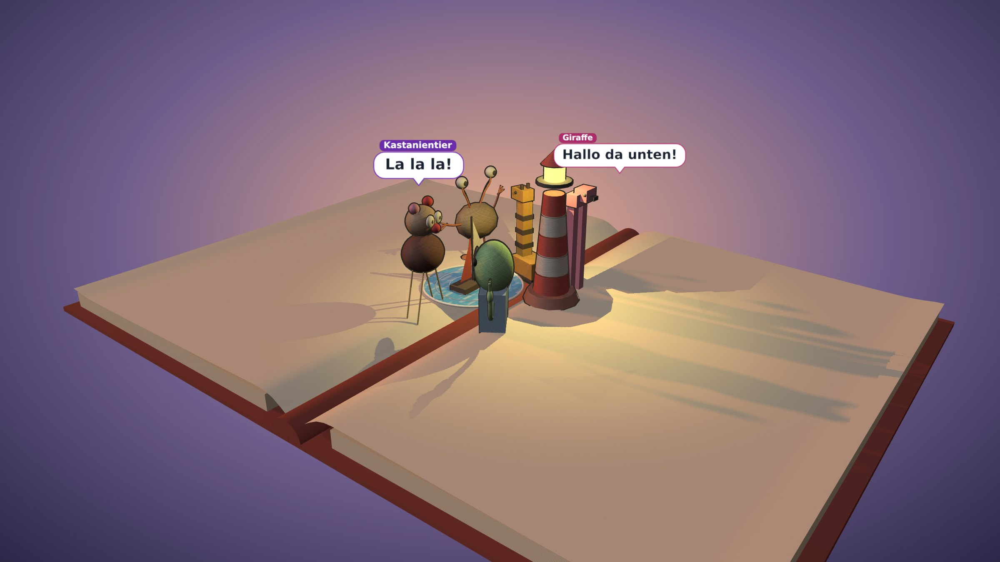
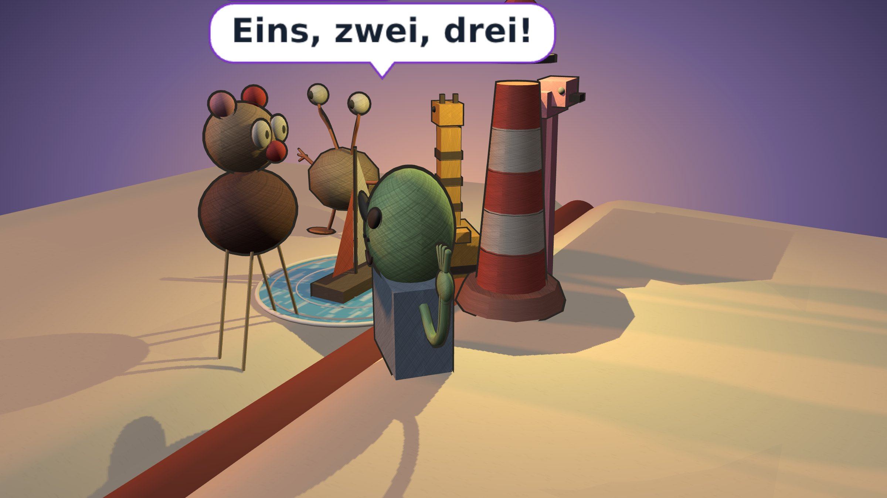
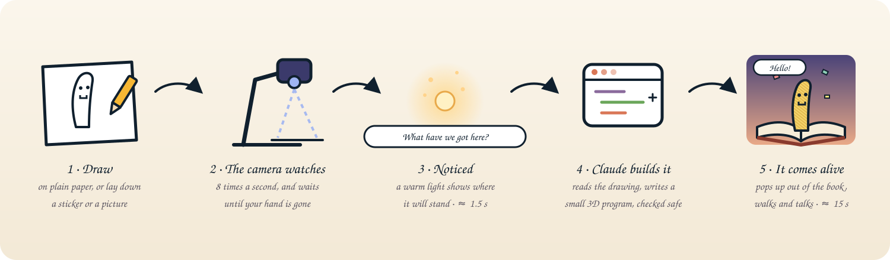

<p align="center">
  
</p>

<h1 align="center">Kritzel</h1>

<p align="center"><b>Draw on paper. Watch it come alive in a pop-up book.</b><br>
A camera watches your sheet of paper. Every drawing, sticker or cut-out picture becomes a living thing on the pages of a 3D pop-up book.</p>

<p align="center"><sub><i>Kritzel</i> /ˈkʁɪtsl̩/, say <b>KRIT-sl</b> (rhymes with <i>pretzel</i>): German for <i>a scribble</i>.</sub></p>

<p align="center">
  
  
  
  
</p>

<p align="center">
  
</p>

## What it does

Draw something on a sheet of paper under the camera, take your hand away, and a moment later
it stands up out of the pages of a pop-up book on screen, coloured in with pencil like your
drawing. A person walks off and says hello, a bird flies loops and lands, a fish swims in the
pond you drew, a spider sits in the jail you drew around it. The characters have moods and
friendships, talk to each other in short little dialogues, play tag and dance, and come over to
look whenever something new arrives.

- **Draw a moon** and night falls, with stars. **Draw a sun** and it's day. **Draw a lamp, a
  candle or a campfire** and everyone gathers in its warm light.
- **Draw weather:** a rain cloud brings rain and puddles (they hop in them), snowflakes bring
  snow, a rainbow makes everyone cheer, lightning sends them running for cover.
- **Label a drawing** ("Vogel", "Fels", "Haus!" with an arrow) and it is read as that.
  **Cross something out** or scribble over it and it goes away; colouring in never does.
- **Stickers, cut-outs and brochure pictures** come alive too: a LEGO snake from a booklet
  becomes a brick snake on the page.
- **Tap a character** and it hops and says hello; tap a thing and it wiggles; a long press
  follows a character with the camera.

The world can grow sheet by sheet (**Hinzufügen**), or always show exactly what is on the
paper right now (**Wechseln**). **Neue Welt** turns the page to an empty one; old worlds are
kept.

<p align="center">
  
</p>

### From paper to book in seconds

<p align="center">
  
</p>

About **1.5 seconds** after the pen lifts, a warm light appears where the new thing will
stand, and the status pill says what Kritzel is looking at: *„Was haben wir denn da? Ein Affe,
ein Baum …"*. About **15 seconds** later the thing pops up out of the page with confetti and
its name, and the others walk over to look. A whole new sheet takes about 24 seconds.

## What else it can do

- **Characters with a life of their own:** moods, friendships and little fears; they walk, hop,
  crawl, fly, swim or climb, depending on what they are, and keep out of each other's way.
- **Short dialogues** in speech bubbles, every line an answer to the one before, with a name
  and a colour for each speaker; thoughts float up in thought clouds.
- **German and English:** switch with DE | EN at the top right, for the buttons and for what the
  characters say.
- **A look that belongs together:** everything is coloured in with pencil strokes and outlined,
  whether you drew it or Kritzel added it.
- **The camera can be anywhere at home:** a document camera on another computer works too.
- **Made for children:** everything the characters say is checked to be friendly; pictures that
  aren't right for small children and photos of real people are not brought to life.
- **Little sounds** for every word and every arrival, no recordings.

## What you need

- **A camera looking straight down at the paper.** We use the
  [IPEVO V4K](https://www.amazon.de/dp/B079DLTG9F), a document camera on a bendable arm.
  Any webcam works, but a camera fixed above the sheet sees the drawing best.
- **A stable surface under the paper,** a board or desk mat the sheet can't slide on.
- **Plain white paper,** A4 or larger, with the whole sheet inside the camera's view.
- **Good, even light:** a desk lamp or daylight from the side, without hard shadows from
  hands or the camera arm. Warm room light is fine.
- **A screen to show the book:** a laptop, a tablet next to the paper, or a TV.

## Getting started

You need a computer with Linux for Kritzel itself (the camera may sit on another computer) and
a Claude account for reading the drawings. No API key is needed.

```bash
git clone https://github.com/ssalentin/kritzel.git && cd kritzel
./kritzel setup     # checks what's missing and says how to fix it
./kritzel start     # starts everything and opens the book in your browser
```

Then click **📷 Kamera** in the book, choose your camera, and start drawing.
`./kritzel stop` stops everything.

If the camera is plugged into another computer at home, run this there once:

```bash
git clone https://github.com/ssalentin/kritzel.git && cd kritzel && ./kritzel camera
```

**How it works inside**, from the camera to the code that brings a drawing to life, is in
[docs/technical.md](docs/technical.md).

## Credits

Inspired by [this post on X](https://x.com/noahlt/status/2108675665373589841) about a
document scanner setup with an LLM.

Kritzel is a prototype, made with [three.js](https://threejs.org/), [rot.js](https://ondras.github.io/rot.js/)
and [Claude](https://claude.com), by a small team of AI agents with one person deciding what's
worth building.
